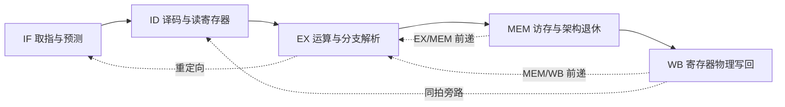

# 面向CNN推理的R-V结构设计

**CPU5 · RV32IM 五级流水线处理器 · MES50HP FPGA 实现**

本仓库交付作品中的自研处理器子工程：使用 Verilog 实现 IF、ID、EX、MEM、WB 五级单发射顺序流水线，支持 RV32IM、整数前递、BTB64、两路 I/D Cache、UART、GPIO及最小机器态控制。CPU5 已完成 **50 MHz 实板 CoreMark 双种子测试**和链表、矩阵、状态机三类算法的 ILA 采样。

作品面向 CPU 与 CNN 专用逻辑协同的应用结构。本仓库的性能、资源与波形对应**独立 CPU5 工程**；音频采集、CNN 模型及完整声音识别 SoC 不包含在本次 CPU5 代码交付中，其结果应由对应系统工程说明。

## 评审入口

| 查看内容 | 入口 |
| --- | --- |
| 阅读顺序、代码定位与复现步骤 | **[作品代码与验证说明](docs/submission/README.md)** |
| 固定提交的源码、上板文件与原始证据 | **[CPU5 提交版本与下载](https://github.com/a-learner-1/riscv_5stage/releases/tag/v1.0.0-cpu5)** |
| 板级顶层 | [cpu5_coremark_board_top.v](rtl/cpu5_coremark_board_top.v) |
| 五级流水线主体 | [cpu5_alu_pipeline.v](rtl/cpu5_alu_pipeline.v)、[级间数据定义](rtl/cpu5_pipeline_types.vh) |
| 实板结果及三类算法波形记录 | [结果 JSON](docs/cpu5_board_results_20261028.json)、[证据导航](docs/evidence/cpu5_board_20261028/README.md) |
| 设计、接口和各阶段验证文档 | [文档目录](docs/README.md) |

## 处理器结构



MEM 是唯一架构退休点，WB 完成已经退休结果的通用寄存器物理写回。有效位、指令年龄及事务所有权共同约束回压、冲刷、异常和外设副作用；STORE、分支、CSR 与 MRET 的退休事件与 GPR 写使能分别定义。

| 项目 | 正式 CPU5 板级配置 |
| --- | --- |
| 平台 | MES50HP，紫光同创 Logos PGL50H-6IFBG484 |
| 指令集 | RV32IM，ILP32，小端；单发射、顺序执行与退休 |
| 已验证工作点 | 50 MHz，20 ns 约束；不据此推定理论最高频率 |
| 存储 | 32 KiB ROM、16 KiB D0 同步 BRAM |
| Cache | I/D 各 2 KiB；两路、64 组、16 字节行 |
| 数据写策略 | 写穿透、不写分配，无写缓冲 |
| 分支控制 | 64 项 BTB，EX 解析与重定向 |
| 外设与控制 | UART 115200 / 8N1、GPIO、mtime/mtimecmp、MSIP、最小机器态 CSR与中断 |
| 外部数据接口 | 32 位 AXI4-Lite，单笔在途 |
| 统计 | schema4/profile2，十类互斥周期、64 位周期及退休计数 |

## 实板结果

| CoreMark 指标 | performance | validation |
| --- | ---: | ---: |
| 迭代次数 | 2000 | 2000 |
| 算法运行时间 / 秒 | 15.526302740 | 15.546583040 |
| CoreMark | **128.813667587** | 128.645631960 |
| CoreMark/MHz | **2.576273352** | 2.572912639 |
| CPI | 1.339822844 | 1.340521074 |
| CRC 与运行判定 | FORMAL PASS | FORMAL PASS |

正式成绩采用 performance；validation 用另一组种子核对正确性。两组均运行超过 10 秒。`FORMAL PASS` 是本工程 CoreMark 移植层的有效运行判定，含 CRC、迭代及计时检查，不表示形式化验证工具证明。

正式双种子构建的综合资源为 **10837 LUT、8870 寄存器、28 DRM18K 等价、4 APM**；50 MHz 最终 STA 的 Slow Setup WNS 为 **+0.021 ns**，失败端点为 0。资源分母包含整个 CPU 板级设计。带 ILA 的调试构建单独实现、单独记录，不计入以上正式资源。

三类 ILA 窗口均为 173 位数据、1024 点、50 MHz 采样，覆盖顺序推进、乘法驻留、字符读取、分支目标恢复及 STORE 暂停。局部窗口事件数不替代全程 CPI，也不用于推断未采集信号的停顿原因。详细数值见[板测结果](docs/cpu5_board_results_20261028.json)。

## 下载与使用

只查看代码可直接浏览本仓库；需要上板或核对原始波形，使用[提交版本下载页](https://github.com/a-learner-1/riscv_5stage/releases/tag/v1.0.0-cpu5)中的文件：

| 文件 | 用途 |
| --- | --- |
| Source code | 对应提交版本的仓库源码；大体积 LFS 证据另行下载 |
| CPU5_board_downloads.zip | MES50HP 的 performance/validation SBIT、BIN 与同包身份清单 |
| CPU5_board_evidence.zip | 原始串口、时序及三类算法 ILA 的既有证据归档 |
| SHA256SUMS.txt | 两个下载附件的 SHA-256 校验值 |

下载附件复用已有冻结文件，没有重新生成位流或修改原始证据。上板须使用相匹配的开发板与约束；串口配置为 115200、8N1、无流控。操作与预期结果见[复现说明](docs/submission/README.md#使用既有位流上板)。

使用 Git Bash 克隆源码，可先跳过历史大证据：

```bash
GIT_LFS_SKIP_SMUDGE=1 git clone https://github.com/a-learner-1/riscv_5stage.git
cd riscv_5stage
git lfs install --local
```

需要最新板测原始归档时，可从下载页获取，或执行：

```bash
git lfs pull --include="docs/evidence/cpu5_board_20261028/raw_evidence.zip"
```

构建工具为 RISC-V GCC 15.2.0、ModelSim 10.6e、PDS 2022.2-SP6.4及 Python 3.10+。固件、PDS 实现、仿真及历史验收的不同入口见[完整复现说明](docs/submission/README.md#从源码构建)。

## 目录与扩展

| 目录 | 内容 |
| --- | --- |
| [rtl/](rtl/) | CPU5、公共 Cache/总线/外设及历史实现 |
| [software/cpu5_coremark/](software/cpu5_coremark/) | CPU5 启动、链接和 CoreMark 移植 |
| [benchmarks/coremark/](benchmarks/coremark/) | CoreMark 算法、来源与许可证 |
| [tb/](tb/) / [tests/](tests/) | 模块、处理器、系统 testbench 与工具测试 |
| [tools/](tools/) | 固件、仿真、构建、验收和源码导出工具 |
| [pds/](pds/) | 引脚与时钟约束 |
| [docs/](docs/) | 设计文档、提交说明与冻结证据 |

CNN 开发从 [CPU5 接入指南](docs/integration/cpu5_cnn_handoff.md)开始。AXI4-Lite 控制接口、共享缓冲区、Cache 一致性及 IRQ 需要在对应系统顶层确认；独立 CPU 的 CoreMark 成绩不作为 CNN 端到端性能。根目录旧脚本与历史记录保留原路径，当前五级实现以本页指定入口为准。

CoreMark 第三方来源与使用条款见 [SOURCE.md](benchmarks/coremark/SOURCE.md) 和 [LICENSE.md](benchmarks/coremark/LICENSE.md)。
